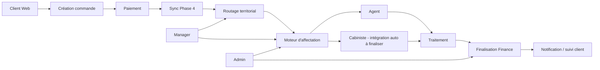

# IzyTel

Plateforme de commande, traitement et suivi de services télécoms en Côte d’Ivoire.

IzyTel couvre plusieurs surfaces :

- application mobile Flutter pour **Agent**, **Manager**, **Administrateur** et **Cabiniste** ;
- Web Client / PWA pour les clients ;
- Back-office Web pour les opérations, l’équipe, la finance, le support et le pilotage ;
- backend hybride **Firebase + Supabase/PostgreSQL**.

> **Important pour tout nouveau développeur** : le code réellement présent dans le dépôt reste la source de vérité. Ce README sert de guide de reprise. Avant tout changement, inspecter l’état courant du dépôt, les migrations déjà appliquées et les tests existants.

---

## 1. État actuel du projet

**Baseline fonctionnelle actuelle : WC15D**  
**Suite de tests complète : `All tests passed!`**  
**Dernier audit global : WC15 — Back-office, performances, sécurité et Finance**

Les principales corrections récentes incluent :

- navigation Web Client corrigée ;
- navigation mobile par pile réelle pour Agent / Manager / Admin / Cabiniste ;
- routage territorial des commandes ;
- correction de la synchronisation Phase 4 ;
- correction de l’affectation automatique round-robin ;
- suppression de plusieurs pollings agressifs ;
- migration des principaux flux vers **Realtime + refetch** ;
- correction des refresh infinis ;
- audit Finance et contrôles d’intégrité ;
- optimisation des index PostgreSQL ;
- stabilisation des tests de non-régression.

### Prochaine évolution prévue : WC16

WC16 doit notamment couvrir :

1. routage territorial strict des zones non couvertes ;
2. intégration des Cabinistes dans le moteur d’affectation automatique ;
3. création et gestion complète des comptes depuis le Back-office ;
4. modification sécurisée des identifiants de connexion par l’utilisateur ;
5. tests de non-régression et audit des permissions associés.

---

## 2. Stack technique

### Frontend

- Flutter `3.44.8`
- Dart `3.12.2`
- Material Design / Material Symbols Rounded
- Google Fonts / Manrope

### Firebase

- Firebase Authentication
- Cloud Firestore
- Firebase Storage
- Firebase Cloud Messaging
- Firebase Hosting

Projet Firebase connu :

```text
cabineflow-4bca7
```

### Supabase

- PostgreSQL
- Row Level Security
- RPC PostgreSQL
- Realtime
- Storage

Projet Supabase connu :

```text
zrxeztxaxnzxevjuhzcc
```

Région :

```text
eu-west-3
```

### Outils connus

- Node.js `24.14.0`
- npm `11.9.0`
- Firebase CLI `15.12.0`

---

## 3. Nom technique vs nom produit

Le produit s’appelle **IzyTel**.

Le package Flutter historique peut encore utiliser :

```text
cabine_flow
```

Ne pas renommer automatiquement le package ou les chemins techniques uniquement pour harmoniser le branding : plusieurs imports, configurations Firebase, Android et tests peuvent en dépendre.

---

## 4. Surfaces de l’application

### Application mobile

Rôles supportés :

- Administrateur ;
- Manager ;
- Agent ;
- Cabiniste.

Le mobile Admin reste une surface valide. Le Back-office Web ne le remplace pas complètement.

### Web Client

Entrée dédiée au client :

```text
lib/main_customer_web.dart
```

Fonctions principales :

- consultation des offres ;
- transfert d’unités ;
- souscriptions ;
- choix réseau / offre ;
- bénéficiaire ;
- paiement ;
- suivi de commande ;
- récupération d’une commande ;
- historique ;
- messagerie / support.

### Back-office Web

Entrée dédiée :

```text
lib/main_backoffice_web.dart
```

Destiné principalement à :

- Administrateur ;
- Manager selon son périmètre territorial.

Le Back-office est responsive et doit rester exploitable sur desktop, tablette et navigateur mobile.

---

## 5. Architecture métier simplifiée



---

## 6. Sources de données : règle essentielle

IzyTel est actuellement un système hybride.

### Supabase est la source canonique pour les flux modernes

Notamment :

- affectations Phase 4 ;
- historique d’affectation ;
- capacités ;
- signalements récents ;
- profils Staff modernes ;
- fournisseurs ;
- commissions ;
- Finance Phase 5 ;
- Cabinistes / partenaires ;
- zones ;
- plusieurs flux de support et de pilotage.

### Firebase / Firestore reste présent

Il sert encore pour :

- Firebase Authentication ;
- données historiques / legacy ;
- certains flux pré-sync ;
- certains backfills ;
- compatibilité avec les anciennes phases ;
- FCM ;
- Hosting.

### Règle

Ne jamais ajouter un nouveau double-write Firestore + Supabase sans justification claire.

Avant de modifier un repository, vérifier quelle source est désormais canonique.

---

## 7. Architecture de lecture temps réel

Depuis WC15, les flux sensibles ne doivent plus utiliser de polling chaud toutes les 3 ou 4 secondes.

Le pattern attendu est :

```text
lecture initiale
    ↓
Supabase Realtime
    ↓
refetch sur événement
    ↓
conservation de la dernière donnée valide
    ↓
fallback lent si Realtime indisponible
```

Le helper central est notamment :

```text
SupabaseRealtimeRefetch
```

Principes :

- ne pas recréer les streams dans `build()` ;
- créer/conserver les streams dans `initState()` ou dans le ViewModel ;
- ne pas redémarrer tous les abonnements lors d’un simple pull-to-refresh ;
- éviter les appels RPC dupliqués pendant un rebuild ;
- réutiliser les données déjà disponibles localement quand c’est possible.

---

## 8. Territoires et zones

Chaque commande possède un contexte territorial.

Le routage utilise :

- la position du client lorsque la localisation est autorisée ;
- les zones actives configurées ;
- les coordonnées de la zone ;
- le rayon `coverage_radius_km`.

Une commande couverte est rattachée à sa zone et ne doit être proposée qu’aux exécutants autorisés sur cette zone.

### Comportement actuel à connaître

Lorsqu’aucune zone configurée ne couvre une position, le backend utilise encore une **zone centrale de fallback**.

À la date de cette baseline, ce fallback est configuré sur une zone d’Abidjan.

Cela signifie qu’une commande provenant d’une ville non couverte peut actuellement finir dans la zone centrale.

### Évolution prévue WC16A

Le comportement cible est plutôt :

```text
position hors couverture
→ commande "Zone non couverte"
→ visible Admin
→ aucune auto-affectation distante implicite
→ création/extension d’une zone ou affectation exceptionnelle explicite
```

Ne pas supprimer le fallback actuel sans migration/test complet : plusieurs RPC en dépendent encore.

---

## 9. Affectation automatique Agent

Les règles de base à préserver sont :

- compte actif ;
- disponibilité ;
- zone compatible ;
- réseau autorisé ;
- réseau actif ;
- capacité disponible ;
- quota quotidien ;
- limite de transactions ;
- exclusion des agents ayant déjà refusé la commande.

### Round-robin

L’affectation automatique actuelle tient compte de la dernière affectation réelle.

Exemple avec deux Agents toujours éligibles :

```text
Agent A → Agent B → Agent A → Agent B
```

Si B n’est plus éligible :

```text
Agent A → Agent A
```

Le serveur possède un verrou transactionnel par zone afin d’éviter que plusieurs commandes simultanées choisissent le même Agent à partir d’un snapshot obsolète.

### Refus

Flux attendu :

```text
Agent refuse
→ motif obligatoire
→ historique
→ agent exclu pour cette commande
→ prochaine tentative
→ si tous les candidats ont refusé : intervention manuelle
```

---

## 10. Cabinistes / partenaires

Le socle Cabiniste existe déjà.

Principaux éléments Supabase :

```text
partner_accounts
partner_capacities
partner_capacity_movements
partner_order_proofs
partner_success_finalizations
phase4_partner_assignment_history
```

Le modèle Cabiniste contient déjà notamment :

- identifiant Firebase ;
- code partenaire ;
- nom ;
- téléphone ;
- ville ;
- statut ;
- disponibilité ;
- `zone_ids` ;
- réseaux autorisés ;
- réseaux actifs ;
- capacités Orange / MTN / Moov ;
- quotas journaliers ;
- limites de transactions.

Le backend contient déjà des fonctions dédiées à :

- l’éligibilité Cabiniste ;
- la liste des candidats Cabinistes ;
- l’acceptation / refus ;
- le traitement ;
- les preuves ;
- la finalisation ;
- la Finance Cabiniste ;
- la gestion des zones Cabiniste.

### Important

Le Cabiniste n’est pas encore complètement intégré au **même moteur d’auto-affectation principal** que les Agents.

C’est un objectif WC16B.

Avant de l’implémenter, définir la règle métier entre Agent et Cabiniste lorsqu’ils sont tous les deux éligibles :

- égalité / round-robin commun ;
- priorité Agents ;
- pondération configurable.

---

## 11. Rôles et permissions

### Administrateur

Accès global aux fonctions opérationnelles et financières prévues.

Peut notamment gérer :

- utilisateurs ;
- Agents ;
- Managers ;
- Cabinistes ;
- zones ;
- catalogue ;
- paiements ;
- affectations ;
- remboursements ;
- fournisseurs ;
- commissions ;
- Finance ;
- contrôle / audit.

### Manager

Le Manager est **territorial**.

Il doit être limité à ses zones pour :

- commandes ;
- Agents ;
- Cabinistes ;
- support ;
- signalements ;
- opérations autorisées.

Il ne doit pas recevoir automatiquement les privilèges financiers sensibles de l’Administrateur.

### Agent

L’Agent traite uniquement les commandes qui lui sont affectées.

Il peut notamment :

- accepter/refuser ;
- démarrer ;
- mettre en attente ;
- reprendre ;
- fournir une preuve ;
- terminer / échouer ;
- consulter historique / commissions ;
- gérer ses informations personnelles autorisées.

### Cabiniste

Le Cabiniste possède un espace séparé du Staff classique.

Il utilise sa propre capacité télécom et possède des flux spécifiques de règlement / économie partenaire.

### Client

Le client ne doit pas communiquer directement avec l’Agent pendant le traitement.

Les demandes client sont routées vers le Manager / support IzyTel.

Une commande terminée avec succès peut générer une notification automatique au client.

---

## 12. Cycle de commande simplifié

```text
Client
→ création commande
→ paiement déclaré / confirmé
→ phase3_sync_order
→ phase4_assignment_orders
→ routage zone
→ affectation
→ acceptation
→ traitement
→ preuve
→ succès / échec
→ finalisation financière
→ historique / notification
```

États rencontrés dans les flux récents :

```text
paidReady
assigned
accepted
inProgress
onHold
awaitingCustomerConfirmation
completed
failed
refundPending
refunded
```

Ne jamais changer les valeurs persistées d’un statut sans vérifier :

- le modèle Dart ;
- les mappers ;
- les RPC ;
- les contraintes SQL ;
- les tests ;
- les données legacy.

---

## 13. Finance

La Finance récente repose principalement sur Supabase/PostgreSQL.

### Principes techniques

Les opérations sensibles doivent rester :

- transactionnelles ;
- idempotentes ;
- contrôlées côté serveur ;
- protégées par rôle / zone ;
- auditables.

### Finalisation d’une commande réussie

La finalisation moderne vérifie notamment :

- JWT Firebase ;
- commande affectée au bon exécutant ;
- état valide ;
- preuve ;
- capacité disponible ;
- verrouillage ;
- déduction de capacité ;
- mouvement réseau ;
- commission ;
- ledger ;
- finalisation unique.

Un second appel ne doit jamais redéduire la capacité.

### Modèle commercial de référence

- Orange : marge commerciale **4 %** ;
- MTN : marge commerciale **4 %** ;
- Moov : marge commerciale **4,5 %**.

Ne pas recalculer ces marges en les interprétant comme un pourcentage du solde bonus reçu.

### Modules Finance existants

Le projet contient notamment des flux pour :

- capacités réseau ;
- recharges fournisseurs ;
- dettes fournisseurs ;
- paiements fournisseurs ;
- commissions ;
- paiements de commissions ;
- caisse Wave ;
- crédits clients ;
- remboursements ;
- clôtures journalières ;
- rapprochements ;
- Finance Cabiniste ;
- `order_economics`.

### Dette connue

`order_economics` doit encore être validé par une recette réelle dédiée avant d’être considéré comme totalement éprouvé en production.

---

## 14. Back-office Web

Organisation fonctionnelle générale :

```text
Tableau de bord

Opérations
├─ Commandes
├─ Paiements
├─ Affectations
└─ Commandes échouées

Clients
├─ Demandes clients
└─ Remboursements

Équipe
├─ Agents
├─ Managers
├─ Cabinistes
├─ Zones & capacités
└─ Signalements agents

Administration
└─ Utilisateurs

Catalogue
└─ Offres & tarifs

Finances
Contrôle
Pilotage
```

La navigation actuelle utilise des catégories repliables.

---

## 15. Gestion des utilisateurs — état actuel

Le Back-office sait déjà afficher et gérer une partie des profils et accès, mais la création complète d’un compte Firebase privilégié directement depuis le Back-office reste une évolution prévue.

### Objectif WC16C

L’Admin devra pouvoir :

- créer Agent ;
- créer Manager ;
- créer Cabiniste ;
- créer Admin avec confirmation renforcée ;
- activer / suspendre ;
- attribuer zones ;
- définir réseaux ;
- définir capacités / quotas ;
- réinitialiser l’accès ;
- consulter l’historique de gestion.

### Règle de sécurité

Ne pas créer un compte privilégié avec un simple :

```dart
FirebaseAuth.instance.createUserWithEmailAndPassword(...)
```

depuis la session Flutter Admin.

La création doit passer par un backend sécurisé utilisant les privilèges d’administration Firebase, avec contrôle du rôle Admin et journal d’audit.

---

## 16. Identifiants de connexion — évolution prévue

Objectif WC16D : permettre à chaque utilisateur de modifier ses propres identifiants de connexion.

Séparer :

```text
Profil personnel
≠
Sécurité du compte
```

L’utilisateur pourra modifier, selon les règles retenues :

- e-mail de connexion ;
- mot de passe ;
- informations personnelles autorisées.

Il ne doit jamais pouvoir modifier lui-même :

- rôle ;
- statut actif ;
- zones ;
- réseaux autorisés ;
- quotas ;
- permissions.

Les changements sensibles doivent utiliser la ré-authentification Firebase lorsque nécessaire.

---

## 17. Organisation du code

Le projet suit globalement une organisation Flutter par fonctionnalités.

À inspecter en priorité :

```text
lib/
├─ core/
├─ shared/
├─ features/
│  ├─ agents/
│  ├─ auth/
│  ├─ customer_order/
│  ├─ dashboard/
│  ├─ finances/
│  ├─ messaging/
│  ├─ offers/
│  ├─ orders/
│  ├─ refunds/
│  └─ ...
├─ main.dart
├─ main_customer_web.dart
└─ main_backoffice_web.dart

test/
├─ features/
└─ regressions/

supabase/
├─ migrations/
└─ documentation / historique de cutover

web/
assets/
```

La structure exacte du dépôt courant doit toujours être vérifiée avant modification.

---

## 18. Installation locale

### Prérequis

Vérifier :

```powershell
flutter --version
dart --version
node --version
npm --version
firebase --version
```

Puis :

```powershell
flutter pub get
```

### Configuration externe

Les développeurs doivent disposer des accès/configurations appropriés à :

- Firebase ;
- Supabase ;
- fichiers de configuration Android/Web nécessaires ;
- environnement de test ou de préproduction.

**Ne jamais committer de clé privée, service account, secret, mot de passe ou fichier `.env` sensible.**

---

## 19. Lancement

### Mobile

```powershell
flutter run
```

### Web Client

```powershell
flutter run -d chrome -t .\lib\main_customer_web.dart
```

### Back-office Web

```powershell
flutter run -d chrome -t .\lib\main_backoffice_web.dart
```

Sous macOS/Linux, adapter les séparateurs de chemins.

---

## 20. Tests

### Contrôle minimum après modification

```powershell
flutter analyze --no-pub
```

Puis les tests ciblés du module impacté.

### Contrôle avant fusion importante

```powershell
flutter test --no-pub
```

La baseline WC15D a déjà obtenu :

```text
All tests passed!
```

Tout changement qui casse une suite précédemment verte doit être traité comme une régression jusqu’à preuve du contraire.

### Tests de contrat

Le dossier :

```text
test/regressions/
```

contient de nombreux tests de contrat servant à protéger les comportements historiques.

Attention : certains tests inspectent volontairement le code source et les migrations. Lors d’une évolution architecturale légitime, mettre à jour le contrat correspondant au lieu de réintroduire artificiellement une ancienne implémentation.

---

## 21. Migrations Supabase

### Règle absolue

Avant d’appliquer une migration :

1. vérifier si elle est déjà appliquée en production ;
2. lire son contenu ;
3. vérifier son impact RLS / RPC / données ;
4. exécuter les tests associés ;
5. ne jamais rejouer aveuglément un patch déjà appliqué.

Plusieurs migrations WC13, WC14 et WC15 ont déjà été appliquées directement à la production lors des corrections.

Le dépôt doit rester cohérent avec la production, mais la présence d’un fichier SQL dans `supabase/` ne signifie pas nécessairement qu’il faut l’exécuter de nouveau.

---

## 22. Sécurité Supabase

Le projet utilise Firebase Third-party Auth avec Supabase.

Conséquence importante : certaines requêtes Firebase valides peuvent être exécutées par PostgREST sous le rôle PostgreSQL `anon` si le token ne contient pas de claim PostgreSQL `authenticated`.

Les RPC sensibles doivent donc vérifier explicitement :

- JWT Firebase IzyTel ;
- UID ;
- rôle ;
- zone ;
- ownership / périmètre métier.

Ne jamais considérer `anon` comme synonyme d’utilisateur anonyme dans ce projet sans examiner la fonction concernée.

Les fonctions `SECURITY DEFINER` doivent toujours être auditées avant exposition.

---

## 23. Règles de non-régression

Avant de modifier un flux existant :

1. identifier la baseline ;
2. limiter les changements au périmètre demandé ;
3. éviter les refactorings collatéraux ;
4. vérifier Flutter + SQL + RLS ensemble ;
5. ajouter ou adapter un test ciblé ;
6. exécuter les tests historiques concernés ;
7. faire une recette réelle lorsque le flux touche paiement, affectation ou Finance.

### Ne pas casser

En particulier :

- auto-affectation ;
- round-robin ;
- refus et réaffectation ;
- périmètre territorial Manager ;
- navigation mobile ;
- navigation Web Client ;
- capacités ;
- quotas ;
- paiements ;
- remboursements ;
- commissions ;
- clôture Finance ;
- profil Staff ;
- messagerie Client → Manager ;
- Admin mobile.

---

## 24. UX / Design System

Style officiel :

- Light Premium ;
- blanc + bleu IzyTel ;
- police Manrope ;
- cartes blanches ;
- hiérarchie aérée ;
- Material Symbols Rounded ;
- couleurs réseau uniquement lorsque nécessaires ;
- vert / orange / rouge réservés aux états sémantiques.

Éviter d’introduire une nouvelle identité visuelle sans maquette validée.

---

## 25. Refresh / navigation mobile

### Refresh

Le pull-to-refresh ne doit jamais redémarrer toute l’architecture Realtime d’une page.

Il doit déclencher une lecture ponctuelle bornée, conserver les abonnements existants et ne pas laisser un spinner infini.

### Navigation

Le retour Android doit :

```text
sous-page
→ page précédente du même onglet
→ racine de l’onglet
→ Accueil
→ double retour pour quitter
```

Changer d’onglet ne doit pas détruire systématiquement la pile interne de cet onglet.

---

## 26. Procédure de contribution recommandée

Avant de commencer :

```powershell
git status
git branch --show-current
git log -1 --oneline
flutter analyze --no-pub
```

Pour une évolution :

```text
1. lire le code réel
2. repérer les tests existants
3. comprendre la source canonique
4. modifier le minimum nécessaire
5. ajouter/adapter les tests
6. lancer analyze
7. lancer tests ciblés
8. lancer suite complète si changement transversal
9. faire recette réelle si nécessaire
10. documenter migration / comportement
```

Éviter les grosses réécritures "pour nettoyer" lorsqu’elles ne sont pas nécessaires à la demande.

---

## 27. Checklist avant Pull Request

- [ ] `flutter analyze --no-pub` est vert
- [ ] tests ciblés verts
- [ ] `flutter test --no-pub` vert si changement transversal
- [ ] aucun secret ajouté
- [ ] aucune migration déjà appliquée rejouée
- [ ] permissions Manager testées si données zonées
- [ ] permissions Agent/Cabiniste testées si affectation modifiée
- [ ] Finance testée si capacité/argent/commission touché
- [ ] pas de polling agressif introduit
- [ ] pas de stream recréé dans `build()`
- [ ] refresh borné
- [ ] navigation retour vérifiée sur Android
- [ ] UI conforme au design IzyTel
- [ ] historique / audit conservé

---

## 28. Dette technique connue

À traiter progressivement :

- optimisation de certaines policies RLS utilisant encore `auth.jwt()` ligne par ligne ;
- remplacement de quelques pollings Client restants par Realtime/Broadcast ;
- pagination serveur supplémentaire lorsque les historiques Finance grossiront ;
- recette réelle complète de `order_economics` ;
- traitement propre des données legacy pré-cutover ;
- suppression du fallback territorial silencieux vers la zone centrale ;
- moteur unifié Agent + Cabiniste ;
- gestion complète des comptes depuis le Back-office ;
- édition sécurisée e-mail / mot de passe par l’utilisateur.

---

## 29. Roadmap immédiate — WC16

### WC16A — Couverture territoriale stricte

- détecter explicitement les zones non couvertes ;
- ne plus auto-affecter silencieusement à la zone centrale ;
- fournir une file Admin "hors zone" ;
- permettre l’extension/création de zone.

### WC16B — Exécuteurs Agent + Cabiniste

- candidats de même zone ;
- réseaux ;
- capacités ;
- quotas ;
- refus ;
- historique ;
- choix de stratégie Agent/Cabiniste ;
- round-robin / pondération serveur.

### WC16C — Comptes Back-office

- création sécurisée Firebase Auth côté serveur ;
- création profil métier ;
- rôle ;
- zones ;
- statut ;
- suspension ;
- reset d’accès ;
- audit.

### WC16D — Sécurité du compte

- changement e-mail ;
- changement mot de passe ;
- ré-authentification ;
- confirmation / vérification ;
- conservation des permissions administratives hors contrôle utilisateur.

### WC16E — Audit / non-régression

- Client ;
- Admin ;
- Manager ;
- Agent ;
- Cabiniste ;
- territoire ;
- Finance ;
- sécurité ;
- suite complète.

---

## 30. Pour un développeur qui reprend le projet

Commencer par :

```text
1. Lire ce README en entier.
2. Vérifier la branche et le dernier commit.
3. Lire les dernières migrations Supabase.
4. Lire les tests du module à modifier.
5. Vérifier la source de données canonique.
6. Exécuter flutter analyze.
7. Exécuter les tests avant de changer le code.
8. Ne jamais considérer un ancien document de phase comme plus fiable que le dépôt actuel.
```

En cas de doute sur un comportement, rechercher d’abord dans :

```text
test/regressions/
supabase/
lib/features/
```

Les tests de non-régression documentent souvent mieux l’intention actuelle qu’un ancien patch ou qu’une ancienne capture d’écran.

---

## 31. Support produit

Numéro support IzyTel actuellement connu :

```text
+225 0152368290
```

La messagerie IzyTel est le canal opérationnel principal pour les demandes liées aux commandes ; WhatsApp reste un canal complémentaire lorsque prévu par le workflow.

---

## 32. Principe final

> **Préserver ce qui fonctionne, partir de l’état réel, garder le serveur autoritaire sur les règles critiques, tester chaque évolution et ne jamais sacrifier la traçabilité pour aller plus vite.**

